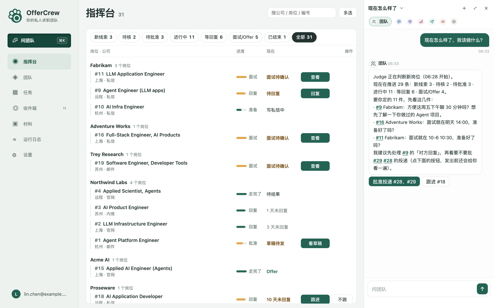
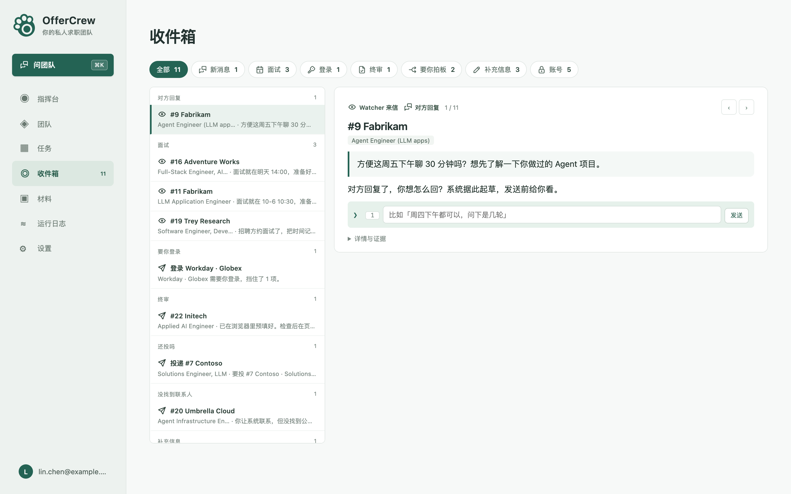
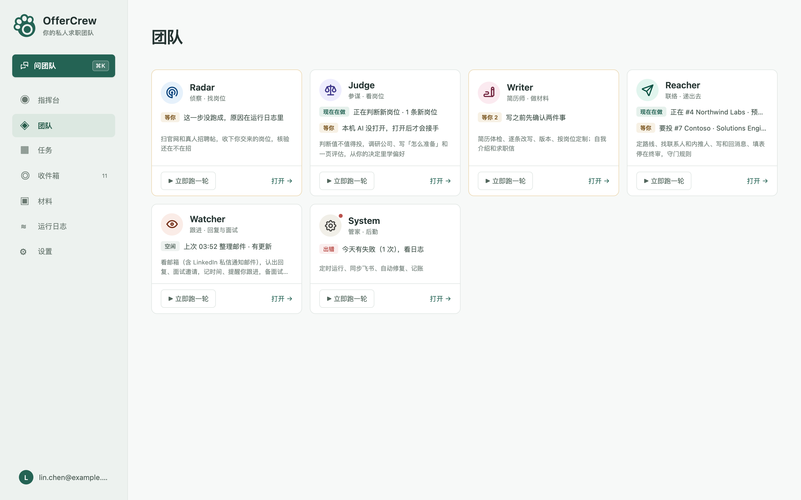
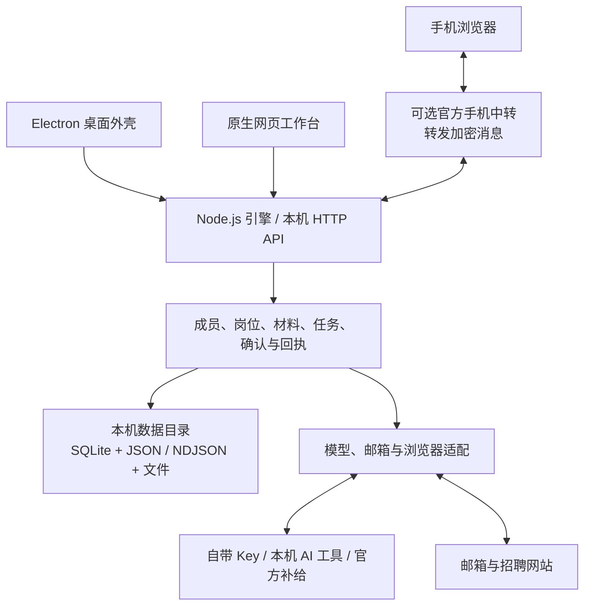

<p align="center">
  
</p>

<h1 align="center">OfferCrew</h1>

<p align="center"><strong>你的私人求职团队</strong><br>Your personal job-search crew</p>

<p align="center">
  <a href="https://offercrew.onemaple.cc/">官网与下载</a> ·
  <a href="#快速开始">快速开始</a> ·
  <a href="docs/RUNNING.md">运行指南</a> ·
  <a href="https://github.com/onemapl3/offercrew/releases">版本记录</a> ·
  <a href="https://github.com/onemapl3/offercrew/issues">反馈问题</a>
</p>

OfferCrew 是在 Mac 上运行的 AI 求职助手。六位成员围绕同一份求职记录协作：发现岗位、判断匹配、准备材料、联系招聘方、跟进回复和整理面试资料。把跨招聘网站的机会、材料和进度放在一个工作台，你负责筛选和拍板。

**自动预填，你来提交。** 申请表预填后由你检查、提交；邮件和私信提供草稿审阅、确认与结果回执。

本仓库提供 **0.2.0 完整客户端源码**，采用 [PolyForm Perimeter 1.0.1](LICENSE)，属于**源码可用（source-available）**项目。商业中转服务端不在公开范围内。



*官网公开演示截图。界面中的岗位、消息与人物用于展示产品，不代表真实求职成果。*

[功能](#六位成员一条求职流程) · [更多界面](#产品预览) · [配置](#模型与必要配置) · [架构](#简要架构) · [许可](#许可)

## 六位成员，一条求职流程

| 成员 | 帮你完成什么 |
| --- | --- |
| **Radar · 找岗位** | 从招聘官网和公开招聘帖发现机会，收录你提供的链接，核验岗位是否仍在招聘。 |
| **Judge · 看岗位** | 根据个人资料与岗位要求判断匹配，整理公司调研、岗位评估和准备建议。 |
| **Writer · 做材料** | 导入和编辑简历，检查、改写、管理版本，按岗位准备简历、求职信和自我介绍。 |
| **Reacher · 递出去** | 查找联系人与内推人，准备联络和回复草稿，辅助填写申请表。 |
| **Watcher · 回复与面试** | 读取已连接的邮箱与受支持平台消息，识别回复和面试邀请，整理跟进与面试资料。 |
| **System · 后勤** | 调度任务，展示运行状态、连接问题和模型用量。 |

围绕这些工作，客户端已经提供：

- **指挥台与岗位详情**：集中查看岗位、筛选条件、匹配判断、材料和处理进度。
- **可编辑的求职材料**：导入 PDF、DOCX、TXT 或 Markdown；保留材料版本，导出 Word 和 PDF。改写结合原件、个人资料和你补充的事实进行核对。
- **任务与收件箱**：从对话交办工作，在任务中查看进度和成果，在收件箱处理回复、待确认事项与面试信息。
- **桌面、网页与手机入口**：桌面外壳和本机网页共用同一引擎；手机通过可选的官方中转访问本机工作台。

具体能力取决于模型来源、邮箱连接、网站登录及页面结构。招聘网站可能需要人工登录、核对或接手；当前脉脉消息同步不可用。

## 产品预览

下面两张图片同样取自官网的公开演示数据。

<details>
<summary><strong>收件箱：集中处理回复、提醒和待确认事项</strong></summary>



</details>

<details>
<summary><strong>团队：查看六位成员的职责、工作状态和记录</strong></summary>



</details>

## 快速开始

### 使用 Mac 安装版

从 [OfferCrew 官网](https://offercrew.onemaple.cc/) 下载，适用于 **Apple 芯片的 Mac（macOS 13 或更高版本）**。安装包及版本信息以官网和 [GitHub Releases](https://github.com/onemapl3/offercrew/releases) 为准。

打开后，在引导中导入简历、核对个人资料和求职方向，再选择模型来源。邮箱和招聘网站按需连接。

### 从源码运行

准备 **Node.js 22.19 或更高版本**、npm 和 Git。当前锁文件中的依赖要求 Node.js ≥ 22.19，运行时还需支持 `node:sqlite`。

```sh
git clone https://github.com/onemapl3/offercrew.git
cd offercrew
node --version
node -e "import('node:sqlite').then(() => console.log('SQLite ready'))"
npm ci
npm test
```

`npm test` 在独立临时目录检查数据初始化、合成数据、本地认证和 Word 导出，不使用日常求职数据，也不调用模型或发送外部消息。

启动桌面客户端：

```sh
cd desktop
npm ci
OFFERCREW_DATA_DIR="$(mktemp -d)" npm start
```

这里使用新的临时数据目录，便于与已安装的 OfferCrew 分开体验。长期使用时，将 `OFFERCREW_DATA_DIR` 设为你自己的固定绝对路径。未指定时，桌面默认使用 macOS 的 `Application Support/OfferCrew`；不要让两个实例同时操作同一数据目录。

<details>
<summary>只运行本机网页工作台</summary>

在仓库根目录执行：

```sh
export RADAR_ROOT="$(mktemp -d)"
node bin/data-root.mjs "$RADAR_ROOT"
node bin/serve.mjs --no-workers
```

保留这个终端。在第二个终端进入同一仓库，将 `RADAR_ROOT` 设为第一个终端创建的目录，然后打开工作台：

```sh
export RADAR_ROOT="/absolute/path/to/your/data-directory"
node bin/open-workbench.mjs
```

默认端口为 `4321`。`open-workbench.mjs` 会把本地访问凭据交给浏览器，不要分享它打开的带凭据链接。`--no-workers` 关闭后台执行；页面上主动发起的操作仍按正常规则运行。

如需合成数据演示，在全新的数据目录初始化后，先运行 `node bin/demo-seed.mjs`，再用 `node bin/serve.mjs --sandbox --no-workers` 启动。不要将演示种子写入日常数据目录。

</details>

Electron 下载、开发构建、桌面自检和 PDF 检查的说明见 [运行指南](docs/RUNNING.md)。自行构建的开发 App 默认不检查官方自动更新。

## 模型与必要配置

在引导或设置中选择模型来源；三种方式接入同一套客户端功能：

| 来源 | 需要准备 |
| --- | --- |
| **自己的 API Key** | 可用的服务商、API Key 和模型配置；在设置中测试连接。 |
| **本机 AI 工具** | 已安装、登录且受支持的 Codex 或 Claude Code；可执行能力取决于工具和授权。 |
| **官方补给** | 可用的官方服务连接及相应账户或额度；这是可选外部服务。 |

本机 AI 工具不等于模型离线运行；不同来源的视觉、结构化输出和执行能力有所不同。源码安装不会附赠模型额度。没有可用模型时，仍可读取和导出现有材料。

按使用场景补充连接：

| 场景 | 必要条件 |
| --- | --- |
| 邮件收发、招聘平台消息 | 在设置中连接邮箱，或在专用浏览器登录受支持的网站。 |
| 浏览器辅助与 PDF 导出 | 本机 Chrome / Chromium；Word 导出在本机完成。 |
| 手机访问 | 配对本机客户端并连接官方手机中转；需要网络与本机引擎在线。 |

个人配置和数据与源码分开保存。请勿把简历、邮件、API Key、浏览器登录态或迁移包提交到仓库。模型服务商、邮箱和招聘网站会按对应操作接收必要内容，本地存储不等于没有网络请求。

## 简要架构



桌面、网页与手机操作使用同一套本机 API 和业务记录。SQLite 保存主要任务与动作账本；其他记录与材料以 JSON、NDJSON 和文件形式保存在数据目录。模型接入集中在适配层，所有来源共用同一套客户端业务层。手机与本机客户端之间的消息经端到端加密后由官方中转转发。

| 目录 | 职责 |
| --- | --- |
| [`bin/`](bin/) · [`lib/`](lib/) | 引擎入口、业务模块、模型与浏览器连接、任务和动作记录 |
| [`web/`](web/) | 网页工作台及手机共用页面 |
| [`desktop/`](desktop/) | Electron 窗口、生命周期和桌面集成 |
| [`config/`](config/) · [`candidate/`](candidate/) | 共享规则、提示词和虚构资料模板 |
| [`skills/`](skills/) | 本机执行器使用的任务技能 |
| [`relay/phone/`](relay/phone/) | 手机浏览器客户端与第三方资源 |

更多说明见 [客户端架构](docs/ARCHITECTURE.md)。官方中转的 Worker、运营后台、部署凭据和签名发布流程不在公开源码中；`relay/phone/` 不包含可自行部署的商业中转服务端。

## 文档与反馈

- [运行指南](docs/RUNNING.md)：桌面、网页、模型连接、数据与导出。
- [客户端架构](docs/ARCHITECTURE.md)：模块职责及网络边界。
- [材料工作流](docs/resume-assistant.md)：简历、求职信与自我介绍。
- [面试资料](docs/interview-materials.md)：按岗位、公司与通用资料组织内容。
- [0.2.0 原始分发清单](https://github.com/onemapl3/offercrew/blob/v0.2.0/CLIENT-MANIFEST.json)：该源码发行快照的文件和 SHA-256。
- [提交问题](https://github.com/onemapl3/offercrew/issues)：请附版本、复现步骤和脱敏截图，移除个人资料与凭据。

## 许可

客户端采用 [PolyForm Perimeter 1.0.1](LICENSE)。使用、修改和分发请阅读完整许可及 [Required Notice](NOTICE)；第三方组件按各自许可证提供，见 [第三方通知](THIRD-PARTY-NOTICES.md)。

本仓库的源码公开范围与许可不涵盖商业中转服务端。
